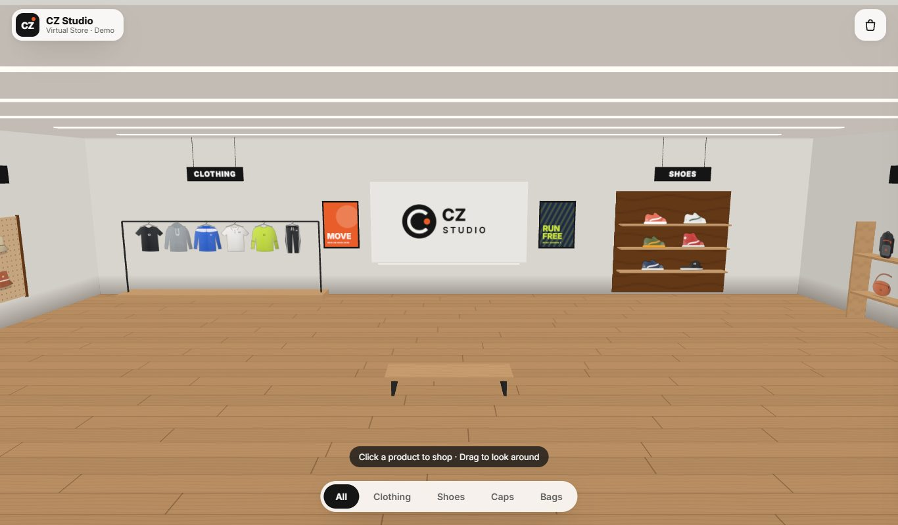
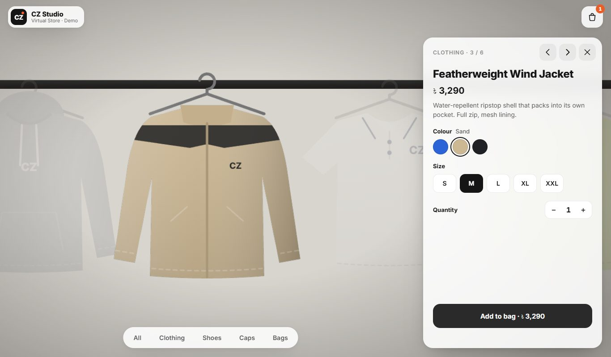
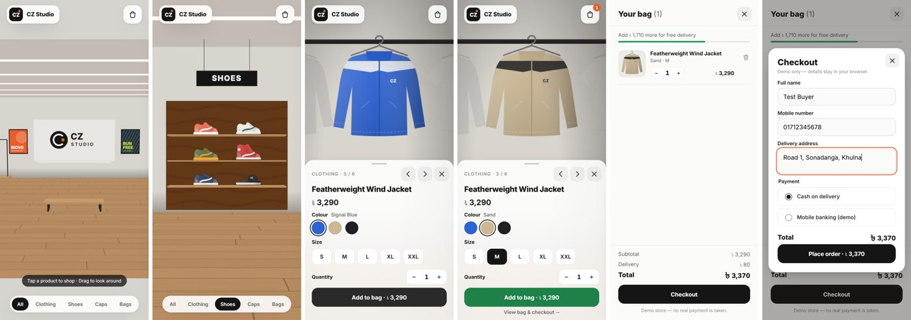

# CZ Studio · 3D Virtual Store

A browser-based 3D clothing store. Walk the room, fly between sections, click a product to zoom in, pick a colour and size, add it to the bag, and go through a demo checkout.

**Live demo:** https://devrkb21.github.io/3d-virtual-store-demo/







## Features

- One gallery room built in code: light walls, ceiling light strips, a wooden floor, a logo wall, framed posters and hanging section signs.
- Four sections: **Clothing** (hanging rail), **Shoes** (wooden shelves), **Caps** (pegboard) and **Bags** (shelf).
- A bottom pill nav (All / Clothing / Shoes / Caps / Bags) flies the camera to each section, after an intro camera move on load.
- Clicking a product zooms to it and dims the rest. A side panel shows the name, price in ৳, colour swatches (the 3D item re-skins live), sizes, quantity, **Add to bag** (it turns green when the item is added) and prev/next arrows. Keyboard: ← → to step through items, Esc to close.
- A bag drawer with line items, quantity controls, a free-delivery meter and totals, plus a fake checkout with BD mobile-number validation. No real payment is taken.
- Hover highlight and pointer cursor on products. You can drag to look around a little. A loading screen shows a progress bar.
- Responsive layout. On phones the product panel becomes a bottom sheet, and the camera framing adapts to the free screen area.
- Built for mid-range phones: DPR is capped at 1.5 on touch devices, there are no shadow maps and only three cheap lights, products use unlit materials, and all textures are 512 px or smaller.

## Stack

- [Vite](https://vitejs.dev/), React 18 and TypeScript
- [React Three Fiber](https://docs.pmnd.rs/react-three-fiber) with [three.js](https://threejs.org/)
- [@react-three/drei](https://github.com/pmndrs/drei): `CameraControls` handles the smooth camera flights and `useCursor` the pointer cursor
- [zustand](https://github.com/pmndrs/zustand) for shared state between the 3D scene and the UI

The repo has **no image assets**. Every product, poster, sign and the floor is drawn on a `<canvas>` at runtime (`src/three/textures.ts`). The same canvases are used as 3D textures and as cart thumbnails. The brand ("CZ Studio") is fictional.

## Run locally

```bash
npm install
npm run dev
```

Then open http://localhost:5173/3d-virtual-store-demo/

To make a production build, run `npm run build`. It writes the site to `dist/`.

## Change the products

All store content is in **`src/data/products.ts`**:

```ts
{
  id: 'essential-tee',
  name: 'Essential Cotton Tee',
  section: 'clothing',          // clothing | shoes | caps | bags
  kind: 'tshirt',               // which drawing to use (see ProductKind)
  price: 890,
  comparePrice: 1090,           // optional, shown struck through
  badge: 'Bestseller',          // optional
  description: '…',
  colors: [{ name: 'Ink Black', hex: '#1d1f22', accent: '#ffffff' }],
  sizes: ['S', 'M', 'L', 'XL'],
}
```

- Add, remove or reorder items and the room lays them out by itself. Clothing hangs on one rail. Shoes go two per shelf, and caps and bags three per row. Shelves are added as rows fill up.
- `kind` chooses the illustration: `tshirt`, `longsleeve`, `hoodie`, `jacket`, `polo`, `pants`, `runner`, `court`, `hightop`, `slide`, `cap`, `bucket`, `beanie`, `backpack`, `tote`, `duffel` or `sling`.
- To use real product photos, return a texture loaded from a transparent PNG in `getProductTexture()` in `src/three/textures.ts`.
- Currency, delivery fee and the free-delivery threshold are in `BRAND` in the same file.
- Section positions, spacing and room size are in `src/three/layout.ts`.

## Deploy

Every push to `main` runs `.github/workflows/deploy.yml`, which builds the site and publishes it to GitHub Pages. If you fork the repo under a different name, update `base` in `vite.config.ts` to match.

## Project structure

```
src/
  data/products.ts       store content (edit me)
  store.ts               zustand state: view, focus, colours, bag
  three/
    Scene.tsx            <Canvas>, lights
    Room.tsx             procedural room, fixtures, signs, posters
    Products.tsx         product planes, hover/dim/focus animation
    CameraRig.tsx        camera flights + look-around limits
    layout.ts            room geometry, product placement, camera framing
    textures.ts          canvas-drawn products and room textures
  components/            loader, top bar, nav pills, product panel, bag, checkout
```
